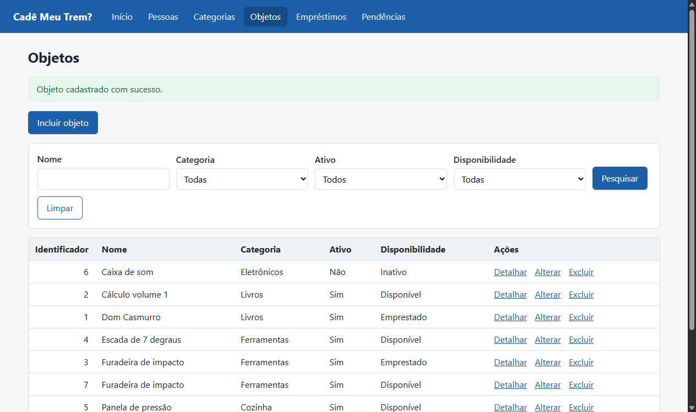
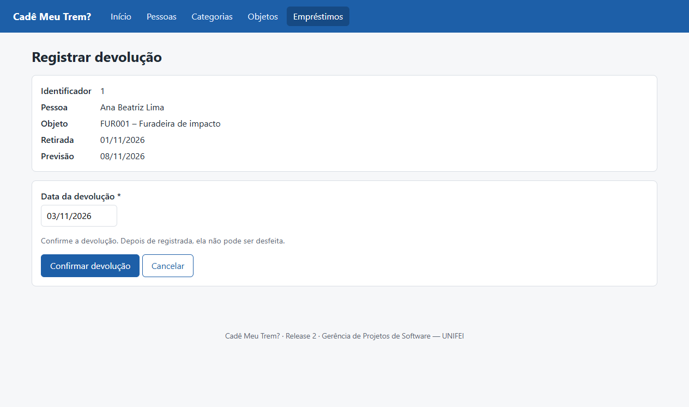
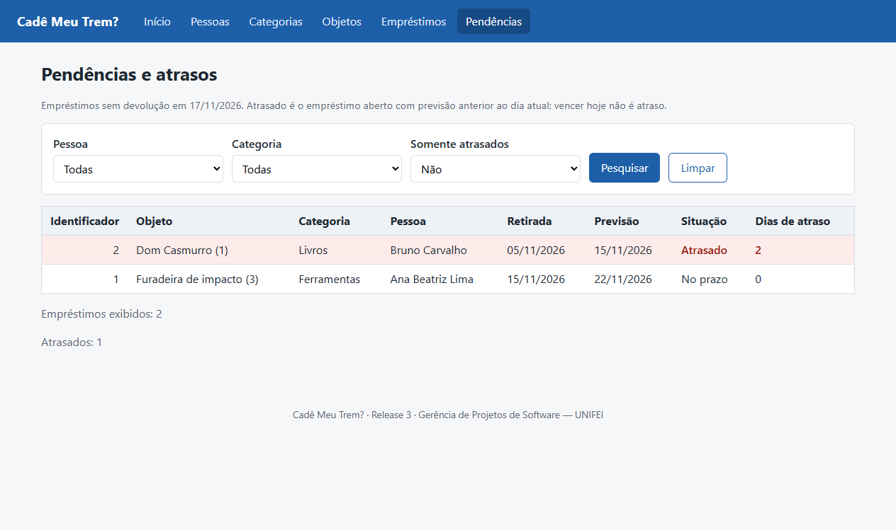
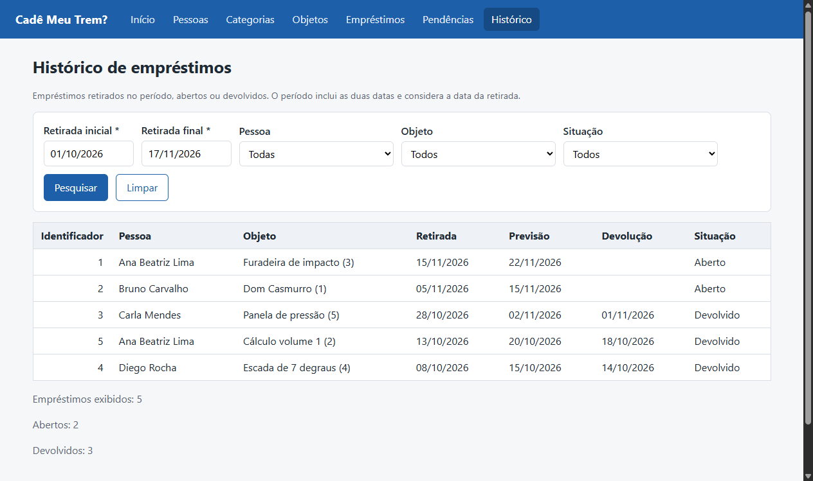

# Manual do usuário — Cadê Meu Trem?

Versão da entrega final (Release 4, 17/11/2026) · Antony Souza Siqueira e Felipe Santana Medeiros

O Cadê Meu Trem? registra quem retirou cada objeto da república, até quando deve devolvê-lo e o que está atrasado.
Funciona no próprio computador, pelo navegador, sem internet. A instalação está no [README](../README.md).

## 1. Abrir o sistema

1. Dê dois cliques em `scripts\iniciar.bat` (ou rode-o no prompt). Deixe a janela aberta enquanto usar o sistema.
2. Abra http://127.0.0.1:8000 no Google Chrome.
3. Para encerrar, feche a janela do `iniciar.bat`.

O menu no alto da página leva a todas as telas: Início, Pessoas, Categorias, Objetos, Empréstimos, Pendências e Histórico.
Campos com * são obrigatórios. Se algo estiver errado, a mensagem aparece no alto do formulário e o que foi digitado
continua preenchido. Toda exclusão pede confirmação.

## 2. Cadastros

### Pessoas

Quem pode retirar objetos. Informe o **nome** (até 80 caracteres), um **contato** opcional (telefone, e-mail, quarto) e se
a pessoa está **ativa**. Nomes iguais são permitidos; o identificador, entre parênteses nas listas, distingue as pessoas.
Só pessoas ativas podem retirar objetos. Uma pessoa com empréstimos registrados não pode ser excluída, mas pode ser
inativada em **Alterar**.

### Categorias

Agrupam os objetos: Livros, Ferramentas, Cozinha... O **nome** (até 40 caracteres) não pode se repetir, sem diferenciar
maiúsculas. Renomear uma categoria muda o nome em todos os objetos dela. Uma categoria com objetos não pode ser excluída.

### Objetos

Cada unidade física tem seu próprio cadastro: duas furadeiras são dois objetos, com o mesmo nome e identificadores
diferentes, por exemplo "Furadeira (3)" e "Furadeira (7)". Informe o **nome**, a **categoria**, uma **observação**
opcional (onde fica, estado de conservação) e se o objeto está **ativo**. Antes de cadastrar objetos, cadastre ao menos
uma categoria.

A **disponibilidade** é calculada pelo sistema: **Emprestado** se houver empréstimo aberto, **Disponível** se o objeto
estiver ativo e **Inativo** se não estiver. Um objeto com qualquer empréstimo registrado não pode ser excluído; inative-o
em **Alterar**.

## 3. Empréstimos e devoluções

### Registrar uma retirada

Em **Empréstimos › Incluir empréstimo**, escolha a **pessoa** (só aparecem as ativas) e o **objeto** (só aparecem os
ativos e disponíveis). A **data da retirada** já vem com o dia de hoje. Informe a **previsão de devolução**, igual ou
posterior à retirada. As datas usam o formato DD/MM/AAAA, e o sistema recusa datas que não existem, como 31/04.

### Alterar, excluir e devolver

Na lista de empréstimos, cada linha tem as ações:

- **Alterar:** muda a previsão (enquanto o empréstimo estiver aberto) e a observação. Pessoa, objeto e retirada não mudam;
  para corrigi-los, exclua o lançamento e registre de novo.
- **Devolver:** registra a data da devolução, entre a retirada e hoje. Depois de registrada, a devolução não pode ser
  desfeita, e o objeto volta a ficar disponível.
- **Excluir:** remove um lançamento feito por engano. Ele sai do histórico; a pessoa e o objeto continuam cadastrados.

## 4. Relatórios

### Pendências e atrasos

Mostra o que ainda não foi devolvido. **Atrasado** é o empréstimo com previsão anterior a hoje; vencer hoje ainda não é
atraso. Os atrasados aparecem primeiro, destacados em vermelho, com os dias de atraso. Filtre por pessoa, por categoria ou
só os atrasados. No fim, o total de empréstimos exibidos e de atrasados.

### Histórico

Mostra os empréstimos retirados num período, abertos ou devolvidos. O período começa, por padrão, no primeiro dia do mês e
vai até hoje, incluindo as duas datas. Filtre por pessoa, objeto e situação. No fim, os totais de exibidos, abertos e
devolvidos. Se a data final for anterior à inicial, o sistema pede a correção.

## 5. Cópia de segurança

Todos os dados ficam no arquivo `data\cade_meu_trem.sqlite`. Com o sistema encerrado, copie esse arquivo para um pendrive
ou para a nuvem. Para restaurar, encerre o sistema, copie o arquivo guardado de volta para a pasta `data` com o mesmo
nome e abra o sistema de novo.
